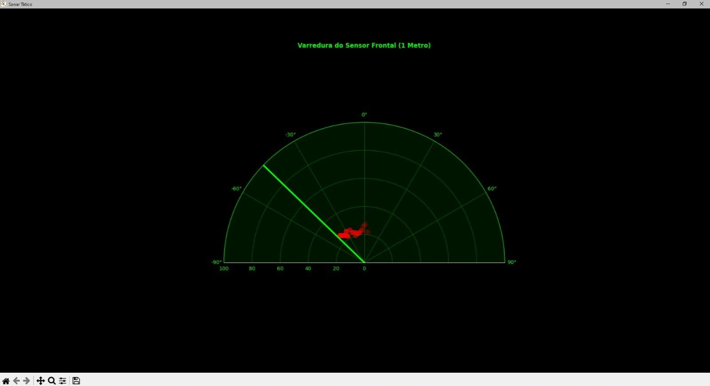

# Interface — Visualização Polar do Sonar Ultrassônico

Esta pasta contém o programa **[`tela_sonar.py`](tela_sonar.py)**, desenvolvido em **Python 3** para receber as medições enviadas pelo **Raspberry Pi Pico** e apresentá-las em uma interface de radar com **Matplotlib**. É a *camada hospedeira* do projeto descrito no artigo *Pensamento Computacional e Matemática Aplicada na Educação: Desenvolvimento de um Sonar Acessível Baseado em Raspberry Pi Pico*, apresentado no **VII ENOPEM**.

**[Voltar ao README principal](../README.md) · [Consultar o Firmware](../Firmware/README.md)**

## 1. Objetivo da interface

A aplicação transforma as leituras do sensor ultrassônico, transmitidas pela comunicação serial, em uma **representação gráfica polar atualizada continuamente**. Para manter as operações separadas, utiliza uma **thread de leitura serial** e a **thread principal para a interface gráfica**.

As funções implementadas no arquivo incluem:

- Estabelecer conexão com uma porta serial configurada no computador.
- Receber linhas de texto contendo **ângulo e distância**, separadas por vírgula.
- Converter ângulos de graus para radianos e atualizar uma linha de varredura em um gráfico polar.
- Representar obstáculos detectados como **pontos vermelhos**, cuja transparência diminui ao longo das atualizações.
- Encerrar a leitura e fechar a conexão serial quando a janela da interface é fechada.

## 2. Arquivo e dependências

| Arquivo | Finalidade |
| --- | --- |
| [`tela_sonar.py`](tela_sonar.py) | Recepção serial, processamento das medições e visualização gráfica do sonar. |

O programa utiliza estas bibliotecas:

| Biblioteca / módulo | Uso no código |
| --- | --- |
| `serial` (**pyserial**) | Abertura da porta serial e leitura das medições. |
| `matplotlib.pyplot` (**matplotlib**) | Construção e atualização do gráfico polar. |
| `math` | Conversão de graus para radianos. |
| `threading` | Execução da leitura serial em thread separada. |
| `queue` | Transferência das medições entre a thread de leitura e a interface. |
| `time` | Pequena pausa no laço de leitura serial. |

**Somente `matplotlib` e `pyserial` exigem instalação adicional**: `math`, `threading`, `queue` e `time` fazem parte da biblioteca padrão do Python.

## 3. Comunicação com o Raspberry Pi Pico

A configuração atual do arquivo é:

```python
PORTA = 'COM7'
BAUD_RATE = 115200
```

`COM7` é a porta definida no computador usado no desenvolvimento; **não é uma porta universal**. Em outra máquina, ajuste `PORTA` para o identificador apresentado pelo sistema operacional (por exemplo, outra `COM` no Windows ou `/dev/ttyACM0` em determinadas instalações Linux).

A conexão é aberta com `serial.Serial(PORTA, BAUD_RATE, timeout=0.1)`. Se a porta não puder ser aberta, o script mostra uma mensagem de erro e interrompe a inicialização.

### Formato dos dados recebidos

O firmware [`Firmware/main.py`](../Firmware/main.py) transmite uma linha no formato:

```text
angulo,distancia_cm
```

**Exemplo ilustrativo do formato** (não corresponde a uma medição documentada no artigo):

```text
20,45.3
```

A interface separa os dois valores pela vírgula e tenta convertê-los para números de ponto flutuante. Linhas sem uma vírgula, com quantidade incorreta de campos ou com valores que não podem ser convertidos são ignoradas pela rotina de leitura.

## 4. Arquitetura com multithreading

O código separa a entrada/saída serial da renderização do gráfico:

```text
Raspberry Pi Pico (MicroPython)
        │
        │  comunicação serial USB
        │  "angulo,distancia_cm"
        ▼
Thread de leitura: ler_porta_serial()
        │
        │  queue.Queue()
        ▼
Thread principal: gráfico polar Matplotlib
        │
        ├── linha de varredura
        └── pontos de obstáculos com transparência decrescente
```

A rotina `ler_porta_serial()` consulta a conexão, recebe uma linha por vez com `readline()`, valida o formato e insere pares `(angulo_graus, distancia_cm)` em `fila_dados`.

```python
fila_dados = queue.Queue()
thread_leitura = threading.Thread(target=ler_porta_serial, daemon=True)
thread_leitura.start()
```

A **thread principal** consome os pares da fila e atualiza os objetos gráficos. Essa é a separação de responsabilidades de leitura serial e visualização apresentada no artigo. O uso de threads não implica que o processamento gráfico seja executado em paralelo em múltiplos núcleos.

## 5. Visualização em coordenadas polares

A interface utiliza um gráfico do Matplotlib criado com projeção polar:

```python
fig, ax = plt.subplots(subplot_kw={'projection': 'polar'}, figsize=(9, 6))
ax.set_ylim(0, 100)
ax.set_theta_zero_location("N")
ax.set_theta_direction(-1)
ax.set_thetamin(-90)
ax.set_thetamax(90)
```

Essas configurações colocam **0° na parte superior**, orientam os ângulos positivos no **sentido horário**, exibem uma região angular de **−90° a +90°** e limitam a escala radial a **100 cm**.

O ângulo recebido é convertido de graus para radianos antes da atualização da linha de varredura:

```python
angulo_rad = math.radians(angulo_graus)
linha_varredura.set_data([0, angulo_rad], [0, distancia_cm])
```

No código, a interface usa fundo escuro, grade verde, linha de varredura verde e pontos de detecção vermelhos. A janela tem o título **“Sonar Tático”**.

### Figura original do artigo

**Figura 3 — Interface gráfica polar de visualização do sonar em tempo real, executada a partir do Prompt de Comando do Windows (artigo, p. 10)**



*Fonte: Figura 3 do artigo. Arquivo extraído da imagem do PDF original, sem recriação.*

## 6. Detecção e decaimento visual dos pontos

O programa adiciona pontos ao histórico somente quando a distância informada satisfaz a condição:

```python
if 2 < distancia_cm < 100:
    historico_pontos.append({
        'ang': angulo_rad,
        'dist': distancia_cm,
        'vida': 1.0
    })
```

Em cada atualização do laço principal, a variável `vida` dos pontos é reduzida pela constante:

```python
TAXA_DECAIMENTO = 0.05
```

Os pontos são removidos quando `vida` deixa de ser positiva. Enquanto permanecem ativos, sua **transparência (canal alfa de RGBA)** diminui conforme o valor de `vida`. Esse efeito visual simula a permanência temporária de alvos na tela de radar.

**Observação:** o decaimento é calculado **por iteração do laço**, não por um tempo fixo em segundos. O script chama `plt.pause(0.03)` para atualizar a interface e permitir o processamento de eventos gráficos, mas isso não estabelece uma taxa de quadros garantida.

## 7. Como executar no computador

**Pré-requisitos:** Python 3, Raspberry Pi Pico com o firmware principal em execução, conexão serial disponível e as dependências listadas no [`requirements.txt`](../requirements.txt).

1. Conecte o Pico ao computador com um cabo USB apropriado e prepare o circuito descrito no [README do Firmware](../Firmware/README.md).
2. Abra um terminal **na raiz do repositório** e instale as dependências:

   ```bash
   python -m pip install -r requirements.txt
   ```

3. Identifique a porta serial do Pico. No arquivo [`tela_sonar.py`](tela_sonar.py), ajuste `PORTA` conforme seu computador. Confira também a configuração `BAUD_RATE` utilizada pela conexão.
4. Garanta que nenhum outro programa (como um monitor serial no Thonny) esteja ocupando a mesma porta.
5. Execute, a partir da raiz do repositório:

   ```bash
   python Interface/tela_sonar.py
   ```

6. A janela do sonar exibirá a varredura à medida que as medições forem recebidas. **Feche a janela** para encerrar o aplicativo.

> A pasta `.venv` de um ambiente virtual local **não precisa ser enviada ao GitHub**. O arquivo `requirements.txt` permite instalar as dependências em outro computador.

## 8. Solução de problemas e limitações

| Situação | O que verificar |
| --- | --- |
| Mensagem de erro ao abrir a porta | Porta selecionada, cabo USB de dados, driver e outros programas usando a conexão. |
| Janela abre, mas não chegam dados | Se `Firmware/main.py` está em execução e se o Pico envia linhas no formato `angulo,distancia_cm`. |
| Os pontos não aparecem | O código só registra alvos com distância **maior que 2 cm e menor que 100 cm**. |
| A janela gráfica não é exibida | Instalação do Matplotlib e disponibilidade de um backend gráfico compatível. |
| As leituras são irregulares | Conexões, alimentação, posicionamento do HC-SR04 e estabilidade da comunicação serial. |

O código original usa uma fila sem limite explícito e ignora exceções que ocorrem durante o laço de leitura serial. Isso é importante para futuras revisões de robustez e diagnóstico, mas **não foi alterado nesta documentação**.

O artigo relata **validação funcional exploratória em bancada** da comunicação serial e da visualização polar. Não apresenta medições quantitativas de latência da serial, taxa de atualização ou desempenho da interface; esses valores **não devem ser inferidos** apenas a partir dos intervalos de pausa definidos no código.

## 9. Referência acadêmica

**Artigo:** *Pensamento Computacional e Matemática Aplicada na Educação: Desenvolvimento de um Sonar Acessível Baseado em Raspberry Pi Pico* — VII Encontro Nacional Online de Professores que Ensinam Matemática (VII ENOPEM).

**Autores:** Anna Beatriz Araújo Cardoso; Marcus Vinicius Santos da Silva; Márcia do Socorro Borges de Araújo Cardoso; André Luiz Cardoso da Silva; Elaine Altino Freire Leite.

A descrição do protótipo, sua arquitetura em duas camadas, a validação funcional e a figura da interface são provenientes do artigo. As constantes e os detalhes de implementação foram verificados diretamente no arquivo [`tela_sonar.py`](tela_sonar.py) presente neste repositório.
