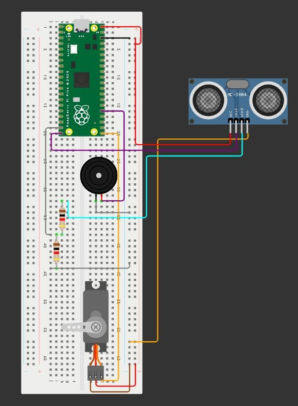
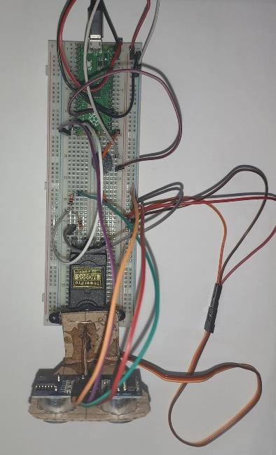
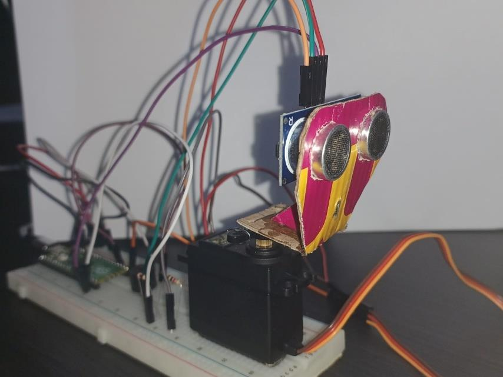

# Sonar Ultrassônico com Raspberry Pi Pico

**Pensamento Computacional e Matemática Aplicada na Educação: Desenvolvimento de um Sonar Acessível Baseado em Raspberry Pi Pico**

Este repositório reúne o código-fonte do protótipo técnico-didático descrito no trabalho apresentado no **VII Encontro Nacional Online de Professores que Ensinam Matemática (VII ENOPEM)**. O sistema foi concebido como uma prova de conceito de baixo custo para apoiar atividades de **Pensamento Computacional, Matemática Aplicada e Sistemas Embarcados**.

O projeto combina o controle de componentes físicos por um **Raspberry Pi Pico (RP2040)**, programado em **MicroPython**, com uma interface de visualização desenvolvida em **Python 3** e executada em um computador.

## 1. Objetivo

Construir e apresentar um sonar ultrassônico de baixo custo, articulando conceitos de ângulos, medidas, proporcionalidade, coordenadas polares, tempo de voo de pulsos ultrassônicos, programação embarcada, comunicação serial e programação concorrente. O estudo foi delimitado à concepção, implementação e **validação funcional exploratória do protótipo**, sem avaliação de sua utilização por estudantes nesta etapa.

## 2. Componentes utilizados

| Componente | Função no protótipo |
| --- | --- |
| Raspberry Pi Pico (RP2040) | Processar a lógica embarcada |
| Sensor ultrassônico HC-SR04 | Medir a distância dos obstáculos |
| Servomotor compatível com PWM de 50 Hz | Movimentar o sensor durante a varredura |
| Buzzer piezoelétrico | Emitir alertas sonoros conforme a distância |
| Protoboard e conexões | Montagem do circuito |
| Computador com Python 3 | Receber dados por serial e exibir o radar |

## 3. Metodologia e arquitetura

O sistema utiliza duas camadas integradas.

**Camada embarcada — Raspberry Pi Pico.** O firmware em MicroPython controla a varredura angular do servomotor, realiza as medições do HC-SR04 a partir do tempo de voo do pulso ultrassônico, define os alertas de proximidade do buzzer e transmite as medições por comunicação serial.

**Camada hospedeira — computador.** Um programa em Python 3 recebe os dados enviados pelo Pico e utiliza **multithreading** para separar a leitura serial da renderização da interface. As medidas são exibidas em um **gráfico polar com atualização contínua**, com decaimento visual dos pontos detectados.

O firmware foi configurado para trabalhar com aproximadamente **180° de varredura**, em incrementos de **2°**, e com alcance operacional limitado por software a **100 cm**. A distância é obtida pela relação entre a duração do eco e a velocidade do som, considerando a ida e a volta do pulso:

\[
\text{distância (cm)} = \frac{\text{duração do eco (μs)} \times 0{,}0343}{2}
\]

O buzzer distingue quatro situações descritas no estudo: **Zona Crítica**, **Zona de Atenção**, **Zona de Detecção** e **Caminho Livre**. No firmware disponibilizado, os limiares são, respectivamente, distâncias inferiores a 30 cm, de 30 a menos de 60 cm, de 60 a menos de 100 cm e iguais ou superiores a 100 cm.

## 4. Figuras originais do artigo

As imagens desta seção foram **extraídas diretamente do PDF do artigo, sem geração por IA, filtros, retoques ou substituições**. As legendas seguem as figuras publicadas.

### Figura 1 — Etapa de pré-montagem e validação do circuito desenvolvida no ambiente de simulação Wokwi



*Fonte: Figura 1 do artigo, página 7 (WOKWI, 2026).*

### Figura 2 — Montagem real do circuito em uma protoboard

| Fotografia original à esquerda | Fotografia original à direita |
| :---: | :---: |
|  |  |

*Fonte: Figura 2 do artigo, página 8. A figura publicada é composta por essas duas fotografias, aqui exibidas lado a lado, sem alterações nos arquivos originais.*

### Figura 3 — Interface gráfica polar de visualização do sonar em tempo real, executada a partir do Prompt de Comando do Windows


*Fonte: Figura 3 do artigo, página 10.*

## 5. Estrutura do repositório

```text
sonar-ultrassonico-micropython/
├── Firmware/
│   ├── calibracao.py
│   ├── main.py
│   └── README.md
├── Interface/
│   ├── tela_sonar.py
│   └── README.md
├── assets/
│   ├── figura1-wokwi.jpg
│   ├── figura2-protoboard.jpg
│   ├── figura2-sonar.jpg
│   └── figura3-interface-polar.jpg
├── .gitignore
├── requirements.txt
└── README.md
```

- **`Firmware/calibracao.py`**: posiciona o servomotor no centro para permitir o alinhamento mecânico da montagem; o valor PWM de 16 bits utilizado no artigo é **4915**, a **50 Hz**.
- **`Firmware/main.py`**: executa a varredura, mede a distância pelo HC-SR04, controla o buzzer e envia pares `ângulo,distância` pela serial.
- **`Interface/tela_sonar.py`**: recebe as medições por uma thread de leitura e atualiza o radar em coordenadas polares com Matplotlib.

## 6. Como executar o protótipo

### No Raspberry Pi Pico

1. Monte o circuito com o **HC-SR04**, o **servomotor** e o **buzzer**, observando a alimentação e as conexões.
2. Instale/configure o **MicroPython** no Pico.
3. Execute `Firmware/calibracao.py` no Pico para alinhar fisicamente o suporte do sensor.
4. Execute `Firmware/main.py` no Pico para iniciar a varredura e a transmissão das medições.

**Pinos utilizados no código:** Trigger do HC-SR04 em **GP15**, Echo em **GP14**, servo em **GP16** e buzzer em **GP19**. O nível lógico dos GPIOs do Raspberry Pi Pico é de **3,3 V**; não aplique sinal de 5 V diretamente no pino Echo. Confira o circuito e utilize adaptação de nível quando necessária, além de alimentação apropriada para o servo e terra comum.

### No computador

1. Tenha o **Python 3** instalado.
2. Na raiz do projeto, instale as dependências:

   ```bash
   python -m pip install -r requirements.txt
   ```

3. Abra `Interface/tela_sonar.py` e ajuste a variável `PORTA` para a porta serial do seu Pico. O código disponibilizado usa `COM7` como configuração local e `115200` baud.
4. Execute:

   ```bash
   python Interface/tela_sonar.py
   ```

5. Feche a janela da interface para interromper a execução no computador.

## 7. Resultados e limitações

Nos **testes de bancada** descritos no artigo, a integração entre a camada embarcada e o computador permitiu a aquisição, transmissão e visualização das distâncias detectadas, com varredura angular e retorno auditivo por faixas de proximidade. O uso de multithreading contribuiu para separar a entrada serial da atualização do gráfico.

A avaliação foi **funcional e exploratória**. O trabalho **não apresentou medições quantitativas** de erro médio de distância, latência serial ou taxa de atualização e **não avaliou aprendizagem, engajamento ou desempenho de estudantes**. Portanto, os resultados não permitem afirmar eficácia pedagógica comprovada.

Entre as possibilidades de trabalhos futuros mencionadas no artigo estão a avaliação com estudantes e a evolução do protótipo para **Raspberry Pi Pico W** e **comunicação sem fio**.

## 8. Artigo científico e autoria

**Título:** *Pensamento Computacional e Matemática Aplicada na Educação: Desenvolvimento de um Sonar Acessível Baseado em Raspberry Pi Pico*.

**Evento:** VII Encontro Nacional Online de Professores que Ensinam Matemática (VII ENOPEM).

**Autores do artigo:**

- Anna Beatriz Araújo Cardoso
- Marcus Vinicius Santos da Silva
- Márcia do Socorro Borges de Araújo Cardoso
- André Luiz Cardoso da Silva
- Elaine Altino Freire Leite

**Instituições indicadas no artigo:** Pontifícia Universidade Católica de Goiás (PUC Goiás) e Instituto Federal de Goiás (IFG), Câmpus Goiânia.

Os autores agradecem às duas instituições pelo apoio institucional. O artigo completo contém a fundamentação teórica e a lista de referências bibliográficas.

---

*Este repositório documenta um protótipo de pesquisa técnico-didática, não um dispositivo de segurança ou medição certificado. As fotografias, a simulação e a captura da interface reproduzem arquivos de imagem existentes no PDF original do artigo.*
